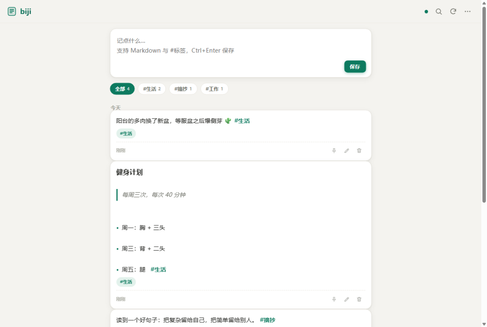
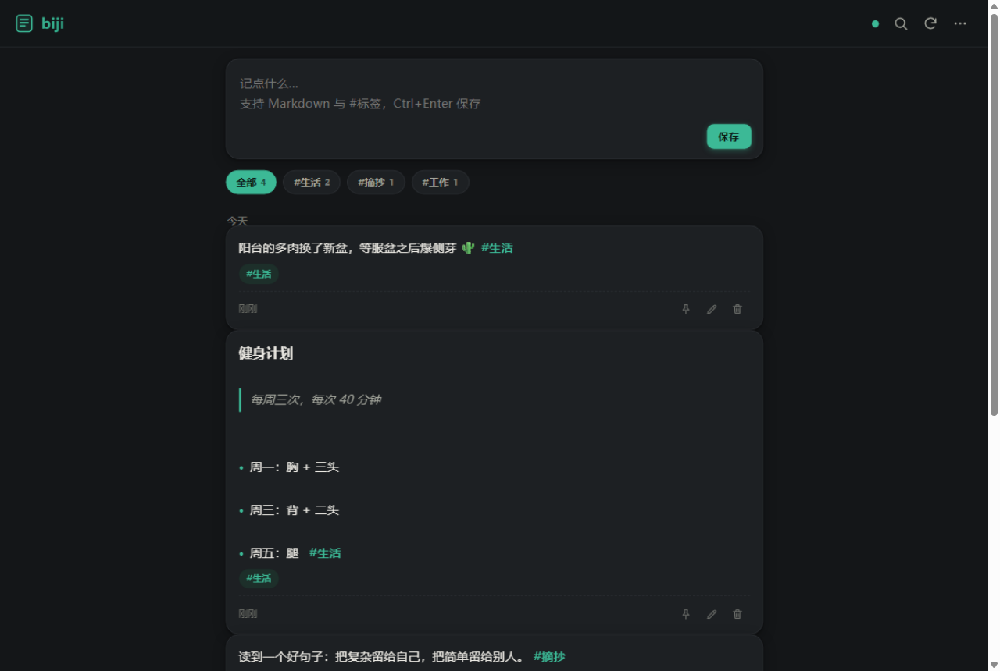
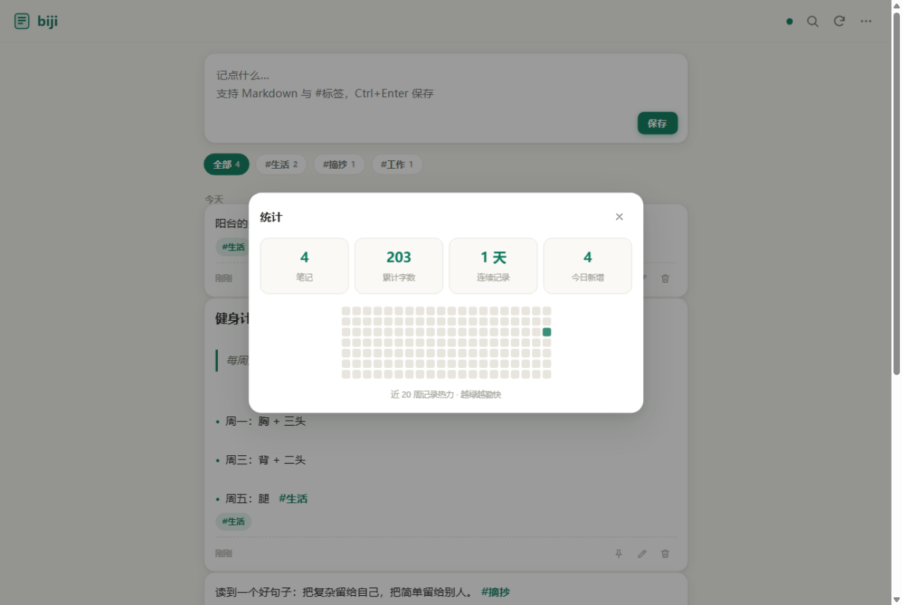

# biji · 端到端加密的多端笔记本

> 纯静态、零构建、零依赖的加密笔记应用：浏览器里写，AES-256-GCM 加密后存进你自己的 Supabase，任何设备打开同一个网址即可同步。服务器上永远只有密文。

<p align="center">
  
  
</p>
<p align="center">
  
</p>

## 🔑 默认密码

**本站默认密码：`123456`**

首次打开时点「一键填入」即可用默认密码开始记录，进入后页面会**弹出提醒，引导你立即修改密码**（也可以随时在「菜单 → 修改密码」修改）。

> ⚠️ `123456` 只是让你零门槛开始的便利默认值，**不是安全密码**。任何拿到网址的人都能尝试解锁。请务必尽快换成至少 8 位、包含字母和数字的密码——修改密码会自动把全部笔记重新加密并同步。

## ✨ 特性

- **端到端加密** — 笔记在浏览器内用你的密码派生密钥（PBKDF2 310k 次 + AES-256-GCM）加密后才上传，数据库、代理层、平台方全都只能看到密文
- **多端同步** — 手机 / 电脑打开同一网址，30 秒自动轮询 + 手动刷新，乐观更新 + 指纹对账，断网时降级到本地缓存
- **Markdown 渲染** — 安全子集：标题、粗体、斜体、行内代码、代码块、删除线、引用、列表，以及**可勾选的任务清单**（勾选即保存）
- **`#标签` 体系** — 自动提取、点击筛选、重命名 / 删除标签（批量改写相关笔记）
- **回收站** — 删除进回收站，30 天后自动物理清除，期间可随时恢复
- **统计热力图** — GitHub 风格近 20 周记录热力、累计字数、连续记录天数
- **每日回顾** — 随机翻出一条 7 天前的旧笔记（flomo 式）
- **PWA** — 可安装到主屏幕，带图标
- **导入导出** — 全量 JSON 备份 / Markdown 导出
- **深色模式 / 移动端适配 / 快捷键**（`Ctrl+Enter` 保存、`Ctrl+K` 搜索、`n` 聚焦输入框）

## 🏗 架构

```
┌─────────────────────┐         ┌──────────────────────┐         ┌──────────────────┐
│  浏览器（静态 SPA）   │  HTTPS  │  here.now 服务端代理   │  HTTPS  │  Supabase Postgres│
│  AES-GCM 加密/解密   │ ──────▶ │  注入 API 密钥        │ ──────▶ │  只存 iv + 密文    │
│  密码 = 钥匙，不出本机 │ ◀────── │  .herenow/proxy.json │ ◀────── │  RLS 行级安全      │
└─────────────────────┘         └──────────────────────┘         └──────────────────┘
```

为什么是三层？三个原因：

1. **密钥不进前端** — API 密钥存在 here.now 账户变量里，由服务端代理注入，即使有人查看网页源码也拿不到
2. **网络可达性** — `*.supabase.co` 在部分网络环境直连不稳，here.now 边缘节点代为转发，浏览器只跟 here.now 说话
3. **零后端代码** — 没有服务器要维护，两个清单文件 + 一张表就是全部

## 🚀 部署你自己的

### 1. Supabase：建项目 + 建表

在 [supabase.com](https://supabase.com) 免费创建项目后，SQL Editor 执行：

```sql
create extension if not exists moddatetime;

create table if not exists public.notes (
  id uuid primary key default gen_random_uuid(),
  iv  text not null,                -- AES-GCM 初始向量（base64）
  ct  text not null,                -- 密文（base64）
  created_at timestamptz not null default now(),
  updated_at timestamptz not null default now()
);

alter table public.notes enable row level security;

create policy "anon select" on public.notes for select to anon using (true);
create policy "anon insert" on public.notes for insert to anon with check (true);
create policy "anon update" on public.notes for update to anon using (true) with check (true);
create policy "anon delete" on public.notes for delete to anon using (true);

create trigger notes_touch before update on public.notes
  for each row execute procedure moddatetime(updated_at);
```

> 加密在前端完成，所以 anon 角色开放全权 CRUD 是安全的——数据库里只有随机密文。

### 2. here.now：发布 + 配置代理

发布本目录（`index.html` 在根级），站点需用免费账户发布（永久 + 代理路由需要账户）。

`.herenow/proxy.json`（把 `YOUR-PROJECT-REF` 换成你的项目 ID）：

```json
{
  "proxies": {
    "/api/db/*": {
      "upstream": "https://YOUR-PROJECT-REF.supabase.co/rest/v1",
      "headers": {
        "apikey": "${SUPABASE_PUBLISHABLE_KEY}",
        "Authorization": "Bearer ${SUPABASE_PUBLISHABLE_KEY}"
      },
      "rateLimit": "60/minute/ip"
    }
  }
}
```

`.herenow/data.json` 用空清单（本应用不用 Site Data）：`{ "collections": {} }`

### 3. 密钥写入 here.now 账户变量

```bash
curl -X PUT https://here.now/api/v1/me/variables/SUPABASE_PUBLISHABLE_KEY \
  -H "Authorization: Bearer $HERENOW_API_KEY" \
  -H "content-type: application/json" \
  -d '{"value":"sb_publishable_xxx","allowedUpstreams":["YOUR-PROJECT-REF.supabase.co"]}'
```

### 4. 发布

```bash
node scripts/publish.js . 
```

完成。打开你的 `{slug}.here.now`，设置密码，开始记笔记。

## 🧪 本地开发

```bash
node dev/mock-server.js 8788   # 模拟 Supabase REST 契约 + 静态托管
# 打开 http://localhost:8788
```

## 🔒 安全模型（诚实版）

- 服务器只有 `iv` 和密文，暴力破解需要先拿到密文再面对 310k 次 PBKDF2 + 你的密码熵
- **默认密码 `123456` 是公开的**，仅用于降低首次使用门槛；进入后应用会主动提醒修改，弱密码（少于 8 位、或纯数字/纯字母）也会触发提醒
- **密码即钥匙：丢失无法找回**，没有后门，没有找回流程
- 同一密码的设备才能互相解密；换密码 = 全量重加密（内置）
- 写入接口对持有网址的人开放（这是无账户静态托管 + 加密保护的代价）：陌生人可以写入垃圾密文或删除记录，但**读不到内容**，客户端会对无法解密的记录显示占位并允许清理；建议不要公开传播网址，重要内容定期导出备份
- 前端对服务器数据按不可信输入处理：先 HTML 转义再渲染，杜绝 XSS

## 🛠 技术栈

纯 Vanilla HTML / CSS / JavaScript，**零依赖、零构建**——单页 + 两个清单文件，`scripts/publish.js` 一条命令发布。灵感来自 [Memos](https://github.com/usememos/memos) 与 [flomo](https://flomoapp.com)。

## License

[MIT](LICENSE)
